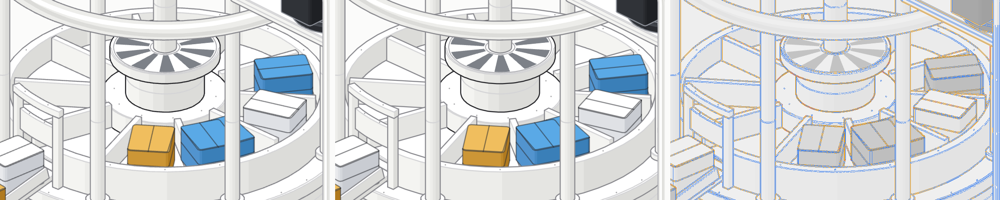
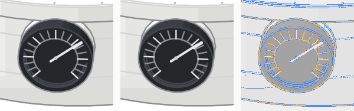
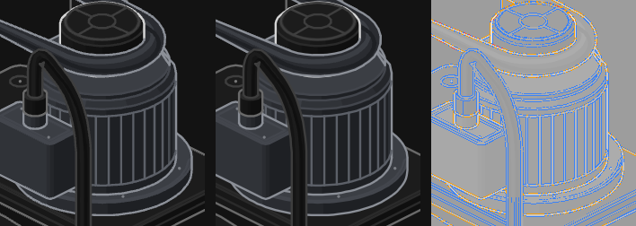

# v3-gpu: a WebGPU (TypeGPU) renderer for the Anatomy factory, prototyped on the centrifuge

*2026-10-13 · prototype scope: the centrifuge standalone page · compared against `../v2-factory/parts/centrifuge/centrifuge(-light).html`*

## TL;DR

- **Quality: indistinguishable at 1×.** The GPU page and the v2 SVG page differ by **0.009–0.010 % of pixels** across the full card at DPR 2 (light and dark). Differences are anti-aliasing on single edges only, and no wrong-tone or missing-part blob appears anywhere. Hairlines (0.4 / 0.6 / 1.3 px), four-tone shading, edges ending on strokes, the gradient void, the halo and the lamp blend all match. Motion has no popping or z-fighting. Light ships and dark is checked. Reduced motion behaves as in v2.
- **Performance: wins everywhere, but it does not fix phones on its own.**
  - One centrifuge: main thread is **−31 % on desktop and −38 % on a 4×-throttled phone**.
  - Ten centrifuges on desktop: **44.9 → 60.0 fps, 25 % → 0 % dropped**.
  - Ten centrifuges on a throttled phone: **11.7 → 15.0 fps**. The rest is v2's own string-building script, which no renderer can remove.
- **Architecture holds up.** It is a DOM-free core (`src/core`, Hermes-compatible) behind a thin web host. Static art is exported once to a binary display list. Live parts run v2's LIVE code *verbatim*: its SVG strings go through a parsing adapter, or a native painter where it matters (the rotor, with one injected line). The core renders through an exact static-layer cache.
- **Recommendation: full GPU port, in phases, about 45–75 engineer-days.** Clean up v2 first (3–5 days). The phone target (50–60 fps) needs the last phase: kit primitives emit typed records instead of strings. Don't do the Canvas2D "baked static runs" hybrid; it doesn't touch the actual bottleneck. Details in [notes/PORT-PLAN.md](notes/PORT-PLAN.md).

**Deliverables:** [centrifuge-gpu-light.html](centrifuge-gpu-light.html) (ships) · [centrifuge-gpu.html](centrifuge-gpu.html) (dark) · [index.html](index.html) · [report/](report/README.md) (all comparison images + numbers). Each page is one self-contained file (1.5 MB raw / 498 KB gzip), with an animated SVG fallback when WebGPU or an adapter is unavailable.

---

## 1. What was built

```
v2 build (unchanged)                         v3 build                                       browser
ctx/R.items ──► page() ──► SVG page ───────► out/svg (baseline + fallback, byte-identical)
     │                                        export/: parse item SVG (strict subset) →
     └────────────────────────────────────►   earcut/libtess fills, polylines, dots,          src/web: boot, palette probes,
                                              gradient, palette keys, slot ranks →            slot interception, fallback
                                              out/dl/*.dl.{json,bin} (lossless wire format) ──► src/core: TypeGPU renderer
v2 runtime.js + LIVE (verbatim) ───────────────────────────────────────────────────────────► src/live: slot strings → geometry
                       + 1 injected line in drawRotor ────────────────────────────────────► src/native: rotor painter
```

| layer | what it does | key facts |
|---|---|---|
| **Exporter** (`export/`) | Runs the real v2 `page()`, captures the settled painter's order, emits a GPU-ready display list | Strict SVG subset; unsupported input throws. 24k triangles, 21k segments, 209 dots. The DL redrawn as SVG matches v2 to 10 px of 2.5 M. |
| **Renderer** (`src/core/`) | 4× MSAA opaque fills with rank-based depth (painter's key + lift·share in a storage buffer); a blended pass in painter's order with analytic-coverage instanced strokes and dots; halo; gradients | Depth comes from painter rank, so reordering for explode is free (no buffer rebuild). bgra8unorm, so blending happens in gamma space like Skia. |
| **Static-layer cache** | Static frame cached once. Per frame, only slots plus the static primitives that reach slot *envelopes* are redrawn (stencil-masked) | **Exact: 0 px vs `?cache=0`** at ~330 adversarial frames, with a committed identity gate. GPU pass ~4.2 → 1.5 ms. |
| **Live adapter** (`src/live/`) | v2 `runtime.js` + LIVE run unmodified; slot `innerHTML` writes are intercepted, parsed, tessellated and uploaded once per tick | Runtime state is bit-identical to the SVG page over 3000 ticks. Group opacity (fading packets) goes through an offscreen atlas. |
| **Native rotor** (`src/native/`) | One build-asserted line in `drawRotor` hands rotor state to an instanced prism painter | Tones use the kit's own arithmetic (exact across 7200 angles). A Node test runs v2's real page script for 3000 ticks and checks the model reproduces v2's strings. Errors drop that machine back to the markup path. |
| **Web host** (`src/web/`) | Palette from CSS tokens via probe elements, DPR/resize, theme, reduced motion, device-loss reinit, SVG fallback, teardown | Fallback reasons are distinguished: `no-adapter`, `init-failed`, `reinit-failed`, `render-error`, `dl-decode-failed`. |

**TypeGPU** 0.12.7 provides typed schemas for every buffer: `d.memoryLayoutOf` gives the packing offsets, flags are shared as `tgpu.const`, and pipelines are compiled ahead with `initAsync`. Shaders are WGSL strings, so no build plugin is needed. Friction points are listed in §6.

## 2. Quality verdict

Method: [report/README.md](report/README.md). Both pages are driven to the same simulation tick with a deterministic lockstep clock, and readouts are checked equal at every shot. Full cards are at DPR 2. Crops are *rendered* at DPR 4, not magnified. The reference is the committed v2 page.

| subject | light: loose % / incl. AA % | dark |
|---|---|---|
| full card 1× | **0.0102 / 0.072** | **0.0088 / 0.044** |
| rotor + packets (native) 4× | 0.0197 / 0.292 | 0.0303 / 0.196 |
| tach dial hairlines 4× | 0.0111 / 0.208 | 0.0111 / 0.244 |
| belt stub edges 4× | 0.0035 / 0.156 | 0.0025 / 0.017 |
| funnel gradient 4× | 0.0219 / 0.202 | 0.0061 / 0.242 |
| halo edge 4× | 0 / 0.033 | 0 / 0.002 |
| motor ribs 4× | 0.0104 / 0.292 | 0.0139 / 0.258 |
| lamp glow (multiply / screen) 4× | 0 / 0.136 | 0 / 0.087 |
| 12-frame motion strip (worst frame) | 0.089 / 0.420 | 0.069 / 0.411 |

How to read the columns:
- **Loose** is pixelmatch at threshold 0.1, ignoring anti-aliased pixels.
- **Incl. AA** counts every anti-aliased difference.
- The **solid-blob** metric (a difference area that survives a 3×3 erosion) is **0 everywhere**. That is the measure for a wrong tone, a missing part or popping.

**Visual comparison** (left v2 SVG · middle GPU · right heatmap: blue ≤ 8 levels, amber ≤ 32, red above):





Full cards: [light v2](report/light-card-v2.png) · [light GPU](report/light-card-gpu.png) · [light heat](report/light-card-heat.png) · [dark v2](report/dark-card-v2.png) · [dark GPU](report/dark-card-gpu.png) · motion strips [light](report/light-strip.png) / [dark](report/dark-strip.png).

**Where the remaining differences come from**, all intentional or outside our control:
1. **Chrome's hairline weights are inconsistent.** The same 0.6 px line draws 48/255 as a one-segment path and 63/255 once the path has a second segment. The GPU draws the true line area. Our calibration holds every one of 228 cells (angles including the 2:1 isometric slope, sub-pixel offsets, DPR 1–3) within 0.87–1.17× of Chrome's ink.
2. **The native rotor skips the kit's 0.1-unit coordinate rounding.** Edges move by at most 0.07 viewBox units. Native vs markup is ≤ 0.004 % of pixels.
3. **MSAA vs Skia AA on fill seams.** The GPU shows *fewer* hairline seams between abutting fills than the SVG does.

**Final QA (picky-designer pass):**
- Side by side at normal 1× viewing, no difference was visible.
- In a rapid A/B toggle a few individual hairlines change weight, which is effect 1 above:
  - on retina, the central column's left outline is ≈ 45 % heavier on the GPU (the red line in the light card heatmap);
  - at DPR 1, the drive belt and the top roller's lower outline are slightly lighter or heavier.
- DPR 1 is the tightest margin: 0.12 % loose against a gate limit of 0.15 %.
- Matching Chrome per path (segment-count-dependent weights) is possible but would mean copying a Skia quirk.

Report: [notes/QA-FINAL.md](notes/QA-FINAL.md).

**Gates.** `npm run gates:full` (≈ 13 min) runs these rows, and every row has a self-test with an injected defect it must catch:
- unit (72 tests, including a renderer on a fake GPU device)
- display-list exactness
- static and live parity at DPR 1/2/4 in both themes
- motion and flicker
- 3000-tick determinism
- cache identity
- native contract and identity
- edge cases (theme switch, resize storm, device loss before or after ready, external destroy, failed submit, zero-size canvas, no WebGPU or null adapter, dispose)
- per-cell hairline calibration
- package checks

See [notes/GATES.md](notes/GATES.md).

## 3. Performance: SVG vs GPU

Measured on an Apple M4 Pro with Chrome, headless with a real Metal adapter. Headless and headed agree within about 10 % per frame. Values are medians of 3 runs. "Phone" = 390 px, DPR 3, 4× CPU throttle. Sources: [out/perf/final/rows.md](out/perf/final/rows.md), [out/perf/baselines.md](out/perf/baselines.md), [notes/FINDINGS-FIXA.md](notes/FINDINGS-FIXA.md), [notes/FINDINGS-M5.md](notes/FINDINGS-M5.md).

| | v2 SVG | GPU (deliverable) | Δ |
|---|---:|---:|---:|
| centrifuge, desktop: main thread ms/frame | 3.11 | **2.16** (+ GPU pass 1.57) | −31 % |
| centrifuge, phone 4×: main thread ms/frame | 10.97 | **6.82** | −38 % |
| 10 centrifuges (iframes), desktop: fps / dropped | 44.9 / 25.2 % | **60.0 / 0 %** | +34 % fps |
| 10 centrifuges, desktop: main thread ms/frame | 22.3 | 13.9 | −38 % |
| 10 centrifuges, phone 4×: fps / main ms | 11.7 / 86.0 | **15.0** / 66.9 | +28 % fps |
| load, desktop: first paint / first GPU frame (ms) | 48 / – | 68 / 134 | the SVG preview shows until the first GPU frame |
| load, phone 4×: first paint / first GPU frame (ms) | 120 / – | 124 / 538 | — |
| payload raw / gzip | 763 / 160 KB | 1,537 / 498 KB | the GPU page also carries the SVG fallback |
| JS heap | 3.5 MB | 18 MB | TypeGPU plus the scene |

How the gains built up over the milestones:

| step | what changed | effect |
|---|---|---|
| M3 live adapter | DOM, style, layout and raster disappear; the SVG strings are still built and parsed | phone main 12.6 → 8.8 ms; stress desktop fps unchanged (GPU-bound at 4 ms/figure) |
| Fix A static cache + stroke shader | GPU only redraws around moving parts | GPU 4.2 → 1.5 ms per figure; stress desktop 42 → 58 fps |
| M5 native rotor | no strings for the 4 rotor slots | single figure −16 % main thread vs markup path; stress desktop clean 60 fps |

**Why phones remain bound.** M6a measured v2 with slot writes frozen. 91 % of SVG GPU raster and 66 % of main thread come from rewriting live slots. But more than half of the remaining script is v2 building SVG strings: kit geometry and number formatting. The simulation itself is under 0.2 ms. A renderer that consumes strings, SVG or GPU adapter alike, keeps that cost. Only typed records, as in the native rotor, remove it. The rotor covers 16 % of the centrifuge's bytes and saves roughly that share. Hence the port plan's P3.

## 4. Parity gaps and open items

| area | status in the prototype | what a factory port needs |
|---|---|---|
| clip paths | not used by the centrifuge; exporter rejects them | the assembly's "well" clip and the sunk-machine clip: stencil or a shader clip polygon (P1) |
| gradients | linear done (funnel void); translucent stops handled | one radial gradient in the factory: same shader path, radial branch (P1) |
| text | none in the figure; card text and readouts stay HTML | 2 `<text>` in the assembly → HTML overlay (P1) |
| hit-testing / accessibility | the centrifuge has no pointer interaction; the canvas has `role=img`, aria-live readouts are preserved, and the live SVG is the accessible image while booting or in fallback | the assembly's `data-ctl` controls: an invisible SVG/HTML overlay, or an ID buffer (P1). v2's playback controls aren't keyboard-reachable today (existing bug). |
| dashed lines | none in the factory | not needed (exporter throws if one appears) |
| fading lines / group opacity | done: offscreen atlas for multi-element groups, per-vertex alpha otherwise | — |
| blend modes / blur | lamp glow multiply/screen and halo blur done | — |
| explode | painter re-ordering is free and the cache is exact under reordering, **but the DL carries no per-item move vectors**, so nothing moves yet | export `move` per item (P1) |
| several figures per page | one GPUDevice per figure; 10 devices worked fine | one shared device and pipeline cache (P2) |
| miter joins, square caps | not used on this page; small gap / round instead | implement when a part needs them |
| browser zoom 125 % / 175 % | slight softness: the canvas lands on a half device pixel; ≈ 0.2 % after snapping, cause of the rest unknown | check on a real display |
| mobile WebGPU | measured only on Apple-silicon Chrome | real iOS Safari / Android Chrome runs are a P3 gate |
| React Native (react-native-webgpu) | `src/core` is DOM-free and Hermes-safe; host sketch in [notes/CQ-FIXA.md](notes/CQ-FIXA.md) | DOM-free runtime port, export-time palette table, typed slot channel (P4) |

## 5. Recommendation: porting the whole factory

The full analysis, with a measured census of every machine and the assembly and four options, is in [notes/PORT-PLAN.md](notes/PORT-PLAN.md). Summary:

| option | factory desktop | factory phone 4× | effort (human days) | verdict |
|---|---|---|---|---|
| today (SVG) | ≈ 54 fps, 18.5 ms main | 12 fps, 85 ms | – | – |
| C: SVG-only wins (60 Hz cap, transform rigid parts, per-piece transforms, will-change) | 60 | 20–22 fps | 6–12 | do the v2-side subset anyway (P0) |
| B: bake static runs into Canvas2D layers (`canvas-painter.mjs`) | 60 at rest | 15–16 fps | 12–20 | **no**: it is a per-frame turn-kit repainter, not a cache; 24 + 25 layers (≈ 15 MB at DPR 3); no effect on script |
| D: GPU static + SVG live overlay | ≈ B | ≈ B | 15–25 | **no**: costs more than B for the same result |
| **A: full GPU port** (adapter, then native/structured painters) | 60 | ≈ 18 fps with the adapter → **50–60 fps** with typed records for the top 4 machines (to verify on devices) | **45–75** | **yes** |

**Phased plan for A:**
- **P0 v2 hygiene, 3–5 days.**
  - Route all live writes through slots: crusher, speaker, scanner and phone bypass them today.
  - Move inline styles to classes, cap at 60 Hz, halt the loop when calm.
  - Per-piece explode transforms.
- **P1 static factory on GPU, 8–12 days.**
  - Exporter gaps: inline paints, rect, matrices, static clips, evenodd, radial gradient, move vectors.
  - Text and controls overlay; DL quantized to i16.
- **P2 live factory via the adapter, 10–16 days.** 64 slots, shared device, per-piece cache.
- **P3 structured channel and native painters, 18–32 days.**
  - Kit primitives emit typed records; native drawing for elevator → packer → audio belt → centrifuge, ranked by measured bytes.
  - Start each painter with the CPU emitter (`?native=cpu`): pixel-identical to compute, no shader, testable in Node. Move to the compute path for machines with many instances.
  - **Kill criterion:** stop if the elevator alone cuts phone main-thread time by less than 30 %.
- **P4 RN host, 6–10 days.**

Agent-orchestrated, P0–P3 is roughly 8–14 working days plus 4–6 days of human review and real-device QA (per-option breakdown in PORT-PLAN §3).

**Top risks:**
- The phone win depends entirely on P3, which rewrites every machine's drawing code.
- Explode motion means full redraws (3–4 ms on M4; unknown on phone GPUs).
- Payload: the factory GPU page is about 1.7 MB gzip unquantized.
- Two render paths forever (SVG fallback); the determinism and live gates guard parity.

## 6. TypeGPU / WebGPU notes

- **Worked well:**
  - typed schemas driving both packing and WGSL (`d.memoryLayoutOf`);
  - `tgpu.const` for flags shared between TypeScript and shaders;
  - `initAsync` precompilation (time to first frame ≈ 305 → 134 ms);
  - timestamp queries without raw WebGPU;
  - one bundle for browser and (planned) react-native-webgpu.
- **Friction** (0.12.7):
  - Spurious `external-omitted` warnings for WGSL-string entry functions, also in production.
  - Several pipelines in one pass need `root['~unstable'].createCommandEncoder()`.
  - `setVertexBuffer` type-checks the schema, so one buffer viewed two ways needs the raw buffer.
  - `root.unwrap` overload picks the compute pipeline.
  - Lazy compile unless `initAsync` is used.
  - Typings need `skipLibCheck`.
  - The bundle is ~285 KB of TypeGPU, with no tree-shaking.

  Details in [notes/FINDINGS-M2.md](notes/FINDINGS-M2.md) and [notes/FINDINGS-M3.md](notes/FINDINGS-M3.md).
- **Headless Chrome on Apple silicon** gives a real Metal adapter with plain `--headless=new`, and CDP screenshots capture WebGPU canvases. In-page `toDataURL` doesn't work. Timestamps are quantized to 65.5 µs unless `--enable-webgpu-developer-features` is passed (`tools/chrome-webgpu.sh`). See [notes/SPIKE.md](notes/SPIKE.md).
- **GPU cost isn't where you'd expect.** Hairlines stay ≈ 1 device px wide, so stroke fragments scale with DPR, not DPR². Every segment pays a padded quad, and DVFS makes idle-clock timings overstate the cost (`?gpuRepeat=4` measures at a steady clock). Caching the static layer was the decisive win, not shader micro-optimization.

## 7. Issues found in existing v2 / kit code

Collected from all agents; none were fixed in v2, which was read-only.

- **Runtime:**
  - `runtime.js` `tick` has no `try/finally` around rescheduling, so one machine's error stops the whole factory.
  - Every slot is rewritten every frame, even under reduced motion (122 KB per frame on the factory, all identical).
  - The loop runs at display rate (2.4× CPU at 144 Hz).
  - dt is capped at 1/30 s, so the simulation slows at low fps.
  - It is a page singleton (two figures collide).
  - `FACTORY` is assigned twice.
- **Assembly:**
  - The explode re-appends every wrapper on any reorder (style and layout 3 → 7 ms per frame during the tour).
  - Live writes bypass slots in crusher, speaker, scanner and phone.
  - Playback controls aren't reachable with Tab.
  - Global SVG ids (`centrifuge-void`, `fx-well`) clash with two figures.
- **Kit / build:**
  - `page()` strips only the first `import` of `lathe.mjs`.
  - The slot target lookup contradicts its "latest" comment.
  - `solidSvg` emits empty `d=""` tops.
  - 9.5 % of fill ring points are duplicates after rounding.
  - The kit's module script contains a literal `</body>`.
  - `parts/*/build.mjs` writes at import, so scenes can't be reused.
  - The committed centrifuge HTML is stale relative to `runtime.js`.
  - `.iso-wire-end` has no cap or join set.
  - `.fx-fluff` uses fixed hex colours (no dark variant) and `fluff` has no palette.
  - The assembly build takes 204 s and 2.1 GB.
- **Tooling:**
  - `drive.mjs --no-webgl` doesn't block WebGPU.
  - `capture.mjs --zoom` only magnifies canvases.
  - `canvas-painter.mjs` silently skips `url()` fills.

Per-milestone details: `notes/FINDINGS-*.md`, `notes/QA-*.md`, `notes/CQ-*.md`, PORT-PLAN §5.

## 8. Reproduce

```bash
cd v3-gpu && npm ci
npm run package        # export display list + build both deliverable pages (and out/gpu/*)
npm test               # 72 unit tests (exporter, live geometry, native model vs v2 code, core on a fake device)
npm run gates          # quick parity suite (~3 min); gates:full ≈ 13 min incl. self-tests
node tools/perf.mjs centrifuge-gpu-light.html --width 390 --dpr 3 --throttle 4 --label phone
node tools/chrome-reap.mjs   # clean any orphaned headless Chrome
```

Dependencies outside the repo:
- The exporter and build import `../v2-factory` (read-only).
- v2's `shared/kit.mjs` **hard-codes the absolute path `/Users/michalsek/.claude/skills/anatomy`** to load the Anatomy kit. Several tools (`capture.mjs`, `drive.mjs`, `chrome-port.mjs`) also come from that skill.
- So rebuilding or gating on another machine needs the skill at that path, or a patched path in v2.
- The deliverable pages themselves are fully self-contained.

A fresh `git archive` + `npm ci` rebuilt both pages byte-identically and passed the quick gates (final QA).

## 9. How this was made

An orchestrated multi-agent loop: a roadmap planner, then per milestone an implementation agent followed by an independent QA agent and a code-quality agent, with fix loops until both passed. Milestones: spike → exporter → static renderer → perf harness → live adapter → architecture/perf fix loop → native rotor → robustness fix loop → packaging. Every review is kept in `notes/` (PLAN, FINDINGS, QA and CQ for each milestone). The git history in `~/Documents/rnaa-anatomy` has one commit per milestone.
